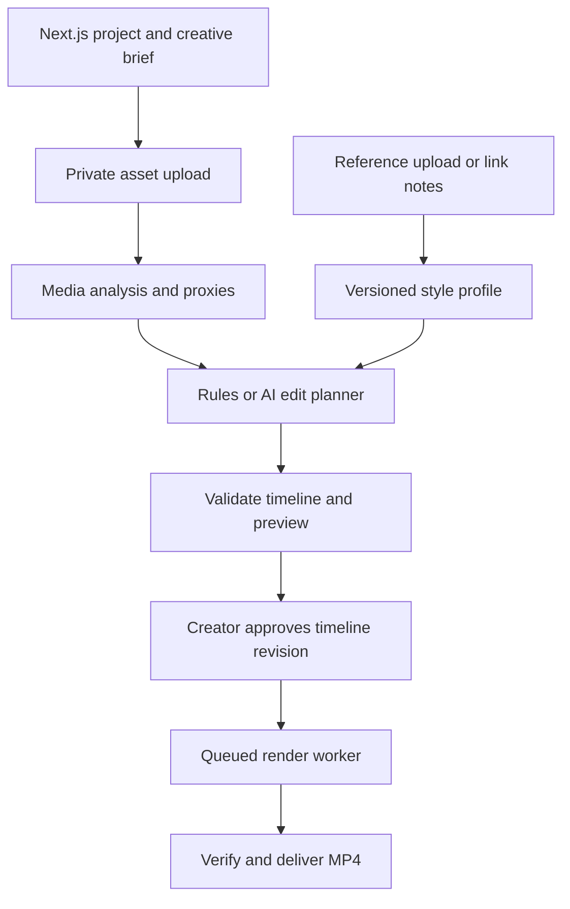

# Pipeline architecture

## Product flow

1. Create a project, set the intended mood and audience, choose a 60–120 second target, and upload photos and short clips. An optional brief identifies the hook, key shots, message, and call to action.
2. Probe actual codecs, image orientation, frame rate, duration and audio tracks. Normalize preview proxies and time bases. Extract shot boundaries, representative frames, speech timestamps, audio levels and beat candidates. Flag unreadable media and insufficient footage with a clear recovery path.
3. Generate a first cut with a strong opening, coherent middle and intentional ending. Use text and music to support the footage. Let the creator regenerate a section, reorder shots, change trims, adjust crops, edit captions, swap effects, and approve the revision.
4. Render the approved timeline to 1080×1920, 30 fps, H.264/AAC MP4. Preserve the intended subject crop, caption safe areas, speech intelligibility, and the 60–120 second final runtime. Use the same timeline and font assets for previews and exports.

## Data and boundaries

| Record | Key fields |
| --- | --- |
| Project | Owner, brief, target duration, brand settings, selected style and current revision |
| Asset | Project, storage key, media type, checksum, probe data, proxy and analysis versions |
| Reference | URL or private uploaded asset ID, permitted use, notes and retention state |
| Style profile | Hook windows, shot-duration ranges, pacing, caption layout, motion, effect preferences and version |
| Timeline revision | Integer frames, ordered source trims, crop/framing, transition durations, overlay/caption cues, audio mix and style version |
| Render job | Immutable revision and renderer version, output profile, idempotency key, attempt, lease, progress and output key |

Next.js handles authenticated project access and signed URLs. Postgres stores metadata and the durable job queue for the first implementation. A separate worker claims jobs using expiring leases and renews them during work. Dedupe by project, revision, renderer version and output profile. Publish outputs from attempt-specific staging keys only while the worker owns the job lease. Retry recoverable failures with limits, surface invalid media or timeline errors, and clean up cancelled or orphaned artifacts. Keep private objects and provider keys out of public URLs and client bundles.

## Validation and creative rules

- Resolve every source ID within the project and check actual trim bounds. Enforce an allowlist for effects, fonts and presets. Validate transition overlaps and calculate duration after overlap in frames (1,800–3,600 at 30 fps).
- Start with hard cuts, beat cuts, cross-dissolves, push/whip transitions, gentle punch-ins, photo pan/zoom, captions, and music ducking. Reserve stronger effects for emphasis. Keep transitions and text animation configurable by style.
- Accept only supported codecs and enforce file and decoded-media limits. Treat inputs and reference notes as untrusted. Use no arbitrary URL fetching or shell interpolation in the worker. Keep originals private and provide deletion and expiry controls for derivatives.
- Verify container, streams, duration, aspect ratio and audio peaks with ffprobe and FFmpeg. Add editorial review for pacing, continuity, color, safe-area captions and sound before declaring a preset production-ready.
